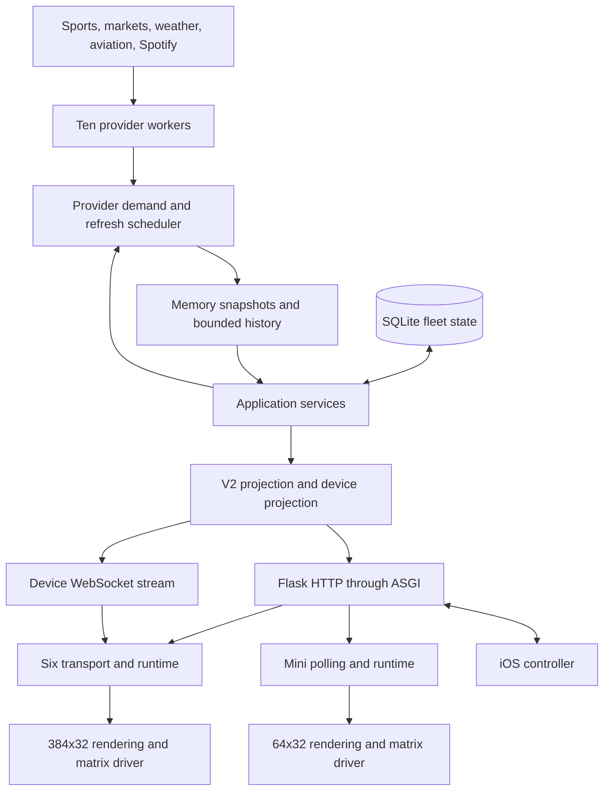
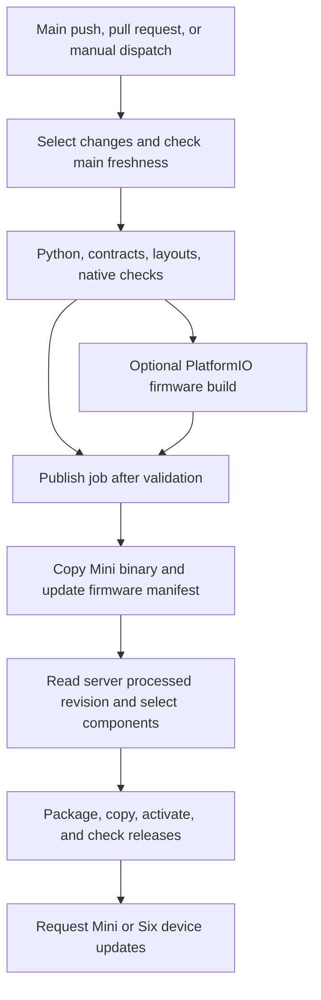

# Project map and cleanup plan

Source revision: `c3cebe6cfc3b2897b83adc27a97e0f997224909d`.
Review date: 2026-10-27.

This map covers the tracked repository at the source revision.
It combines file inventory, Python import analysis, duplicate-function analysis, and targeted source inspection.
It describes source structure. It does not verify production state or complete hardware behavior.
The showcase website is outside the cleanup scope. No website files changed during this review.

Use [the complete file inventory](project-inventory.csv) to find every tracked path.
Use [the Python import inventory](project-imports.csv) to inspect static internal imports.
Import rows include local function imports. Dynamic imports and runtime calls need separate inspection.

## System flow

The backend projects domain facts. Clients own local presentation and device behavior.
Golf and racing are content families within sports presentation. They are not separate top-level V2 modes.
Pairing is an effective output state. Alerts, news, connection loss, and updates are overlays.

## Component map

| Area | Main entry or owner | Responsibility |
|---|---|---|
| Server startup | `sports_ticker/server.py`, `asgi.py`, `production.py` | Configure Hypercorn, adapt HTTP, own runtime lifespan, compose live dependencies. |
| Injected server setup | `sports_ticker/bootstrap_v2.py`, `wsgi_v2.py` | Construct an application from supplied providers and database inputs. |
| HTTP boundary | `sports_ticker/api/app.py`, `api/routes.py` | Register V2 routes, authorize requests, validate input, serialize responses. |
| Device stream | `sports_ticker/device_stream.py`, `asgi.py` | Publish snapshots and sequenced deltas, manage resume and notification behavior. |
| Application orchestration | `sports_ticker/application/composition.py` | Connect fleet settings, schedules, snapshots, events, commands, and device projections. |
| Refresh execution | `application/runtime.py`, `scheduler.py`, `refresh.py` | Run cadence, select due work, fetch provider results, publish complete snapshots. |
| Provider demand | `application/provider_demand.py` | Select provider work from ticker settings and schedules. |
| Schedule policy | `domain/schedule.py`, `application/schedule.py` | Define schedule records, resolve blocks and conditions, apply overrides. |
| Snapshot state | `application/state_store.py`, `domain/snapshot.py` | Retain current immutable snapshots and bounded delayed content history. |
| Canonical data | `domain/models.py`, `events.py` | Define settings, content, and overlay events. |
| Fleet storage | `fleet/repository.py`, `fleet/models.py` | Store tickers, pairing, credentials, schedules, events, and Spotify records in SQLite. |
| Hardware capabilities | `fleet/profiles.py` | Define supported output modes and device geometry. |
| Update records | `fleet/update_ledger.py`, `firmware.py` | Track updates and describe available Mini firmware. |
| Provider construction | `providers/factory.py` | Construct one named provider and its source dependencies. |
| Provider infrastructure | `contracts.py`, `features.py`, `normalization.py`, `http.py` | Define provider results, normalize payloads, manage shared source behavior and transport. |
| Sports facts | `providers/sports_display.py` | Assign canonical sports display facts and team ownership. |
| Output shaping | `projections/data_api.py`, `device_data.py`, `racing_display.py` | Select content and produce public or compact device representations. |
| Mini field specification | `projections/mini_fields.py` | Own the shared Mini payload selection used by generated firmware fields. |
| Spotify | `integrations/spotify.py` | Authorize accounts, refresh credentials, select playback, provide music source data. |
| Server assets | `assets/` | Prepare Mini sprites, artwork, image transforms, and artwork colors. |
| Dashboard and showcase | `dashboard_v2/`, related demo assets and tools | Existing browser and public presentation surfaces. Protected from cleanup changes. |
| Alert browser surface | `display_alerts/` | Serve the separate display-alert web surface. Preserve during this review. |
| Six executable | `ticker_core/__main__.py`, `composition.py` | Construct the Pi application and platform services. |
| Six transport | `protocol/client.py`, `model.py`, `stream.py`, `app/poller.py` | Register, validate snapshots, consume stream events, send health and update results. |
| Six state | `runtime/state.py`, `runtime/model.py` | Select display behavior and maintain mode, overlay, and scrolling state. |
| Six frame pipeline | `app/application.py`, `frame_builder.py`, `viewport.py` | Run frame steps, prepare cards, compose the visible frame. |
| Six rendering | `ui/`, `ui/cards/`, `ui/sports/` | Draw content, overlays, fonts, layouts, and pixel primitives without provider reads. |
| Six assets | `assets/`, `platform/assets.py`, `platform/panes.py` | Plan assets, expose memory reads, persist images and prepared panes. |
| Six hardware | `drivers/`, `platform/` | Drive matrices or emulators, provision Wi-Fi, collect health, execute updates. |
| Mini entry | `esp32_hub75/src/main.cpp`, `mini/runtime/mini_runtime.cpp` | Enter Arduino lifecycle and coordinate firmware state. |
| Mini transport | `mini/runtime/network*`, `http_session*`, `mini/protocol/` | Run network work, parse explicit V2 data, select rotation and pane inputs. |
| Mini presentation | `mini/ui/`, `mini/protocol/panes.h`, `mini/runtime/display.inc`, `mini/runtime/modes.inc` | Read pane facts, draw production 64x32 panes, and present them. |
| Mini hardware | `mini/platform/` | Own Wi-Fi, TLS, BLE provisioning, credentials, firmware updates, sensors, and matrix output. |
| Mini assets | `mini/assets/` | Load sprites and artwork, enforce cache and residency constraints. |
| iOS entry | `TickerControlApp/TickerControl/TickerControlApp.swift`, `ContentView.swift` | Start the app and present its root views. |
| iOS orchestration | `ViewModels/TickerViewModel.swift` | Coordinate settings, requests, schedules, pairing, provisioning, catalogs, and Spotify. |
| iOS services | `Services/` | Provide HTTP transport, credentials, polling, BLE setup, and response ordering. |
| iOS models | `Models/`, `TickerScheduleModels.swift`, `DeviceListState.swift` | Decode V2 data and retain typed controller state. |
| iOS presentation | `Views/`, `TickerScheduleView.swift`, `Preview/` | Render controller screens and schedule previews. |
| Backend operations | `backend_ops/` | Own worker RPC, release selection, activation, recovery, diagnostics, and reporting. |
| Pi installation | `setup.sh`, `updater.py`, `ticker-controller.service`, `test.py` | Install immutable Pi releases, validate activation, and operate the controller service. |

## Provider map

Production defines ten provider components in `backend_ops/worker_contract.py`.
The core calls them over Unix sockets in the deployed service configuration.
Production can also construct providers in-process when `TICKER_WORKER_DIRECTORY` is absent.

| Worker | Source and adapter | Output |
|---|---|---|
| `espn` | `espn.py`, `espn_fastcast.py`, `nhl_live.py` | Scoreboards, live enrichment, sports display facts, and score alerts. |
| `fotmob` | `fotmob.py` | Soccer content and score alerts. |
| `weather` | `weather.py` | Weather content. The core also uses its location resolver. |
| `golf` | `live_sources.EspnGolfSource` → `golf.GolfProvider` | Golf content. |
| `racing` | `racing_live.py`, series modules, sockets → `racing.RacingProvider` | Racing sessions, classifications, and race-control facts. |
| `stock` | `live_sources.FinnhubStockSource` → `stocks.StockProvider` | Market groups and custom symbols. |
| `flights` | `live_sources.FlightRadarSource` → `flights.FlightsProvider` | Tracked flights and airport boards. |
| `music` | `integrations.spotify.SpotifyMusicSource` → `music.MusicProvider` | Ticker-scoped playback. |
| `news` | `live_sources.EspnNewsSource`, `news_transactions.py` → `news.NewsProvider` | News overlays. |
| `clock` | `live_sources.ClockProvider` | Clock content. |

The mode adapters and source classes perform different jobs. Their similar names do not prove duplicate implementations.
The cleanup target is source placement and ownership, not removal of useful adapter boundaries.

## State ownership

| State | Current owner | Required boundary |
|---|---|---|
| Raw responses and upstream caches | Individual provider sources | Keep upstream transport outside renderers. |
| Live scoring history | Provider `ScoreAlertTracker` instances | Preserve ticker scope, baseline behavior, and event deduplication. |
| Current and delayed content | `SnapshotStore` | Preserve replacement revisions and bounded history. |
| Ticker settings and schedules | SQLite repository | Preserve transactions and schedule override expiry. |
| Pairing and controller groups | SQLite repository and application methods | Preserve credential isolation and group ownership. |
| Spotify credentials and OAuth | Repository plus Spotify integration | Keep tokens out of controller and display payloads. |
| Durable overlay delivery | `EventService` plus repository | Preserve targeting, expiry, and acknowledgement. |
| Device commands | Application composition and ticker metadata | Preserve command identity, expiry, and acknowledgement. |
| Stream replay state | `DeviceStreamHub` | Preserve stream identity, sequence, resume, and resynchronization. |
| Six offline content and assets | Pi data directory | Keep runtime data outside immutable releases. |
| Mini credentials and assets | Device storage and firmware caches | Preserve storage limits and network deadlines. |
| iOS credentials and view state | Credential store, device state, view model | Keep selected device and active requests isolated. |
| Deployment state and evidence | Backend manager, incident store, reporting queue | Preserve rollback records and reports until acknowledgement. |

## Confirmed overlaps and cleanup candidates

Each item includes observed evidence and a proposed boundary.
File size supports navigation. It does not prove a design defect by itself.

| Priority | Evidence | Proposed cleanup | Validation |
|---|---|---|---|
| 1 | `services/score_alerts.py` contains another tracker and a module-level singleton. Static searches found no callers outside that file. Active providers import `providers/score_alerts.py`. | Treat the old service as a removal candidate. Confirm external entry points before deletion. Keep the provider tracker as the active owner. | Provider score-alert, football, hockey, and overlay tests. |
| 1 | `live_sources.py` holds five unrelated source classes across 2,436 lines. `backend_ops/components.py:source_owners` walks their AST dependencies for deployment selection. | Split source implementations by mode. Replace symbol-level deployment inference with explicit file ownership in the existing deployment selector. | Provider tests, shutdown tests, component-selection tests, worker tests. |
| 1 | API `_display_settings_value` and repository `_display_payload` enumerate the same settings. Repository `_display_settings` repeats domain defaults. | Define one settings codec with explicit output fields. Keep API request validation and storage migration policy at their respective boundaries. | Settings round trips, patch validation, fleet tests, schedule tests, client contracts. |
| 2 | `espn.py` combines source reads, live caches, event merging, enrichment, normalization, and ticker batching across 3,856 lines. | Split transport/cache, event merging, sport-specific detail adapters, and final provider orchestration. Keep the public provider port stable. | ESPN batch, Fastcast, NHL, scoring, shutdown, and singleflight tests. |
| 2 | `fleet/repository.py` combines schema creation, migrations, fleet records, schedules, events, pairing, and Spotify across 1,813 lines. | Extract schema migrations and domain-specific SQL modules. Retain one connection, lock, and transaction owner. | Pairing/group isolation, SQLite transactions, schedule CRUD, event delivery, Spotify integration. |
| 2 | `application/composition.py:project_data` combines schedule resolution, delay, pairing, device assets, commands, and events. The class also handles registration and control operations. | Extract device output assembly, pairing operations, and command handling. Keep application composition as the coordinator. | Composition, device visibility, schedules, commands, assets, and stream parity tests. |
| 2 | `api/routes.py` registers fleet, schedule, assets, firmware, events, catalogs, and Spotify routes in one 973-line file. | Group routes by resource. Reuse authorization and error helpers while retaining existing paths and response contracts. | API authorization, response, schedule, firmware, and registration tests. |
| 2 | `TickerViewModel.swift` coordinates schedule HTTP, BLE, Wi-Fi discovery, settings, pairing, catalogs, Spotify, and reboot across 1,375 lines. | Extend existing service boundaries with schedule, fleet, settings, and Spotify services. Keep published UI state in the view model. | Swift state and contract tests plus Debug and Release simulator builds. |
| 2 | `mini_runtime.cpp` declares shared mutable state and includes scheduler, protocol, presentation, and connectivity fragments. | Group state into device session, network status, provisioning, and presentation structures. Extract one behavior at a time into compiled modules. | Native payload and pane checks, PlatformIO build, then device timing and memory checks. |
| 3 | Six assets and renderers import server image helpers, palette helpers, and racing rules. Dashboard code also imports Six rendering and asset services. | Consider a small pure display-support package for transforms and drawing facts. Do not move transport, persistence, or provider reads into it. | Asset baselines, music and racing checks, package and deployment ownership tests. |
| 3 | `domain/events.py:_freeze` and `fleet/models.py:_freeze` have identical implementations. `immutable.py:freeze` has similar behavior but preserves keys differently. | Consolidate only after defining mapping-key semantics. Do not replace all three blindly. | Immutable nested payload and key-conversion tests. |
| 3 | `_baseball_player_name` in `sports_display.py:621` matches `_mlb_situation_player_name` in `espn.py:3516`. | Give baseball person-name normalization one owner inside the sports boundary. | MLB situation and sports projection fixtures. |
| 3 | Six production uses `CardCatalog`. Clock tools also use `SceneRegistry` through `create_default_scene_registry`. | Evaluate one renderer registration path. Migrate real clock tool callers before removing registry code. | Clock rendering, bootstrap checks, and deterministic frame renders. |
| 3 | `sports_display.py` mixes shared sports projection with racing flag pixels, number styles, and sport-specific parsers. | Keep one canonical projection owner with smaller internal modules for each sport. Separate domain classification from pixel drawing. | Sports display, competition stage, racing flags, hockey, football, and render baselines. |
| 3 | Six `app/application.py` and `viewport.py` combine many lifecycle and card-worker operations. | Separate device lifecycle and card-worker execution from frame selection after higher-priority work settles. | Poller, lifecycle, viewport, pane-cache, offline, and frame-health tests. |

## Useful boundaries to retain

- Keep provider reads separate from snapshot scheduling and output projection.
- Keep rendering separate from file access, network access, and backend policy.
- Keep Six and Mini renderers separate. Their geometry, memory, and timing requirements differ.
- Keep typed Python, Swift, and C++ contract consumers. Share contract fixtures and generated specifications where practical.
- Keep backend release recovery separate from Pi and Mini device update mechanisms.
- Keep provider result caches, snapshot history, persistent image caches, and frame caches separate. They retain different data for different lifetimes.
- Keep historical worker fixtures in `tests/fixtures/backend_legacy/`. They represent contract evidence, not duplicate production implementations.

## Deployment map

The diagram shows conditional publication stages. Pull requests validate without publication.
Mini and backend selections can skip their respective publication stages.

| Decision or operation | Owner |
|---|---|
| Workflow triggers and job order | `.github/workflows/deploy.yml` |
| Backend, Mini, and Six path selection | `.github/deployment-paths.json` |
| Mini code versus comment publication | `tools/deployment/change_scope.py` |
| Backend process ownership and packaging | `backend_ops/components.py` |
| Core/worker compatibility identity | `backend_ops/worker_contract.py:contract_id` |
| Release activation and rollback | `backend_ops/manager.py` |
| Backend service processes and local guard | `deploy/backend/` |
| Missed-deploy recovery and runtime reporting | `.github/workflows/recover-deploy-trigger.yml` |
| Recovery source comparison | `tools/deployment/deployment_scope.py` |
| Device firmware and update API | `sports_ticker/firmware.py`, `api/routes.py`, `fleet/update_ledger.py` |
| Six release activation | `updater.py`, `ticker_core/platform/update.py`, `update_journal.py` |
| Mini update activation | `esp32_hub75/src/mini/platform/firmware_update.cpp` |
| iOS validation | `.github/workflows/ios.yml` |

Backend deployment consists of the core plus ten independently selected provider processes.
Each selected worker package carries a broad shared dependency set, not only its provider module.
Shared domain and worker-contract changes can require all components to update together.
This makes deployment ownership part of any module move.

Current sequence details:

- Push scope uses the last successful push workflow. Backend packaging uses the server's processed revision.
- The workflow checks main freshness during validation. It does not repeat that check immediately before publication.
- Mini firmware publication modifies `.env` before backend activation. Component rollback does not establish rollback for that earlier change.
- Mini OTA uses a supplied ticker ID or a fixed default. Six update requests target a fixed ticker ID.
- The local backend guard runs every 30 seconds. GitHub monitoring runs every five minutes.
- iOS builds run independently. That workflow builds simulator configurations and runs Swift tests without publishing an app release.
- Public layout generation participates in validation and backend packaging. Preserve that surface during cleanup.

## Support, tests, and tools

| Area | Purpose |
|---|---|
| `tests/python/api/` | HTTP, ASGI, authentication, device projection, and stream behavior. |
| `tests/python/application/`, `runtime/`, `app/` | Backend orchestration and Six frame/runtime lifecycle. |
| `tests/python/protocol/`, `providers/` | Provider fixtures, sports facts, transport, projections, and contracts. |
| `tests/python/fleet/`, `integrations/` | Capabilities, controller groups, and Spotify behavior. |
| `tests/python/assets/`, `features/`, `rendering/`, `clock/` | Asset preparation and renderer behavior. |
| `tests/python/operations/`, `platform/` | Deployment, recovery, tooling, hardware boundaries, and updates. |
| `tests/native/` | Host-compiled Mini payload, cache, networking, and layout checks. |
| `tests/fixtures/` | Captured upstream data, display scenarios, render baselines, and historical worker contracts. |
| `TickerControlApp/TickerControlTests/` | Swift state and serialization checks. |
| `TickerControlApp/ScheduleUITests/` | Schedule UI test sources. CI currently runs Swift package tests and simulator builds. |
| `tools/rendering/` | Deterministic previews and layout generation. Showcase-related tools remain protected. |
| `tools/mini/` | Shared-data generators, native vectors, TLS checks, capture, and asset workbenches. |
| `tools/deployment/` | Deployment scope, device credentials, and authentication utilities. |
| `tools/diagnostics/` | Virtual hardware, live hardware checks, latency, stress, and camera evaluation. |
| `tools/benchmarks/` | Measured rendering, stream, source batching, and performance experiments. |
| `tools/workspaces/` | Task discovery and scoped context preparation. These tools do not select deployments. |
| `tools/experiments/` | Prototype rendering and headline experiments. |
| `docs/contracts/` | Public payload and display contracts. |
| `docs/architecture/`, `development/`, `operations/` | Current ownership, development, and operational guidance. |
| `docs/plans/`, `research/`, `hardware/` | Engineering plans, historical evidence, and hardware labels. |
| `.claude/`, `.codex/`, `.gemini/`, `AGENTS.md` | Agent setup and shared task rules. |

## Recommended sequence

1. Confirm and remove the unused score-alert service. Consolidate small duplicate helpers with explicit semantics.
2. Split `live_sources.py` and update backend file ownership together. Preserve source lifecycle and cache behavior.
3. Consolidate settings conversion. Separate API validation from storage migration rules.
4. Split ESPN ingestion into smaller modules while preserving batching and live-source precedence.
5. Split repository internals and application services while retaining transaction and authorization boundaries.
6. Extract iOS feature services and Mini state owners in separate component changes.
7. Revisit shared drawing support, renderer registration, and Six runtime size after these boundaries stabilize.

For each step, record the behavior owner, removed path, consumer impact, deployment impact, and input/output evidence.
Run focused checks during implementation. Run full repository CI before publication.
No application code changed during this mapping task. No deployment or device update was requested.
